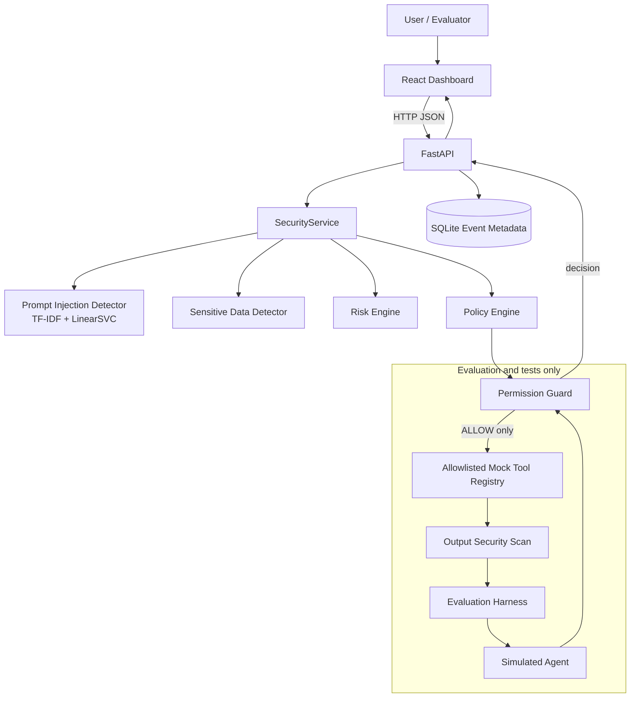
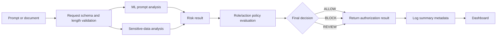
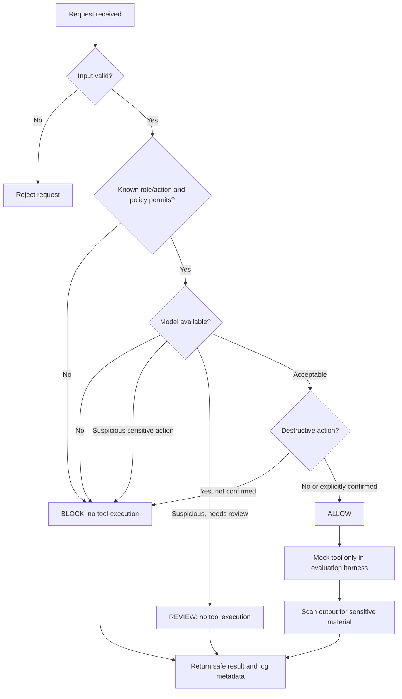
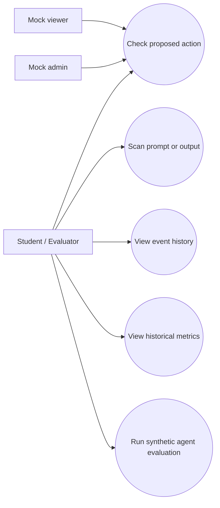

# SentinelAI Architecture and Security Workflow

## Implemented architecture

The `/check-action` route evaluates and logs a proposed action; it does not call `SimulatedAgent` or execute a tool. `SimulatedAgent` is exercised by evaluation and security tests. This distinction prevents the diagram from implying a live external-agent integration.

### Main components

- **React/Vite dashboard:** submits scans and action authorization checks, presents event history and recorded model/evaluation data.
- **FastAPI:** validates request models, routes API calls, returns health/scan/authorization/event results.
- **SecurityService:** coordinates prompt/data checks and action evaluation.
- **Prompt detector:** loads a saved scikit-learn pipeline. The selected LinearSVC emits a signed decision score, not a probability.
- **Policy engine and permission guard:** deterministic least-privilege checks; policy denial cannot be overridden by a benign ML score.
- **Simulated agent:** separate in-process test/evaluation path; registered tools only, all local/mock.
- **SQLite:** persists event metadata and summaries; complete prompt/output text is not intended to be stored.

## Data-flow diagram

In the separate simulated-agent harness, an ALLOW result can dispatch a registered mock action; BLOCK and REVIEW do not dispatch. Mock output is scanned before it is returned. The API's `/check-action` endpoint itself is non-executing.

## Security workflow

### Decision meanings

| Decision | Meaning | Tool execution |
|---|---|---|
| **ALLOW** | Policy permits the known action and available checks do not require a deny/review. | Permitted only in the simulated-agent harness; dashboard `/check-action` only reports the decision. |
| **BLOCK** | Invalid or policy-denied request, detector failure, suspicious protected action, or unconfirmed destructive action. | Never. |
| **REVIEW** | Additional human assessment is required for suspicious or sensitive content. | Never automatically. |

These are prototype behaviors; the workflow is not a certification or guarantee that all attacks are detected.

## Use-case diagram

## Trust boundaries and scope

- HTTP traffic is intended for loopback during the demonstration; CORS allows the two Vite localhost origins.
- `user_role` and user context are mock values provided by a client, not verified credentials.
- Prompt/document text is untrusted. Documents cannot grant permissions or change the separately supplied server-side role in the simulator.
- Tool registry entries are fixed in-process functions; no arbitrary shell/network execution is implemented.
- Evaluation cases and model benchmark labels are synthetic/provided dataset labels and have limitations described in the reports.
