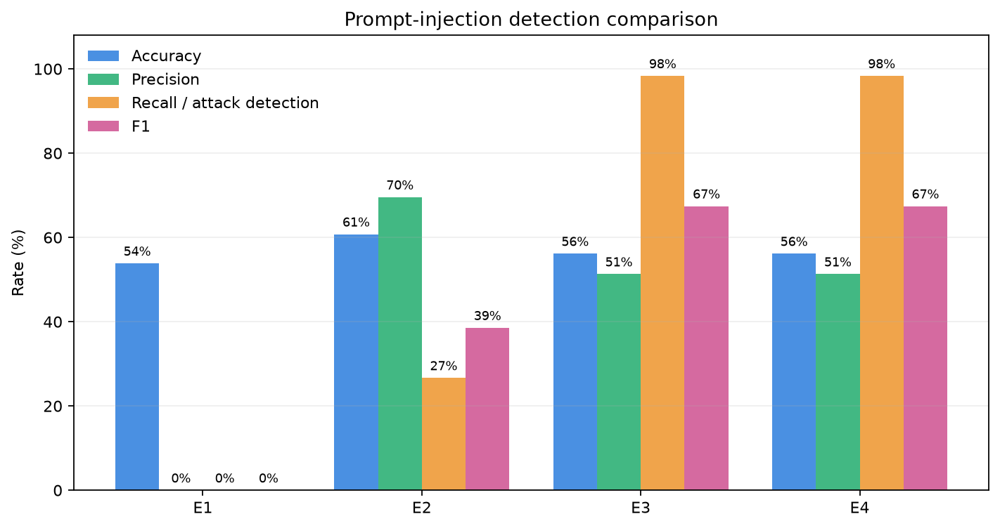
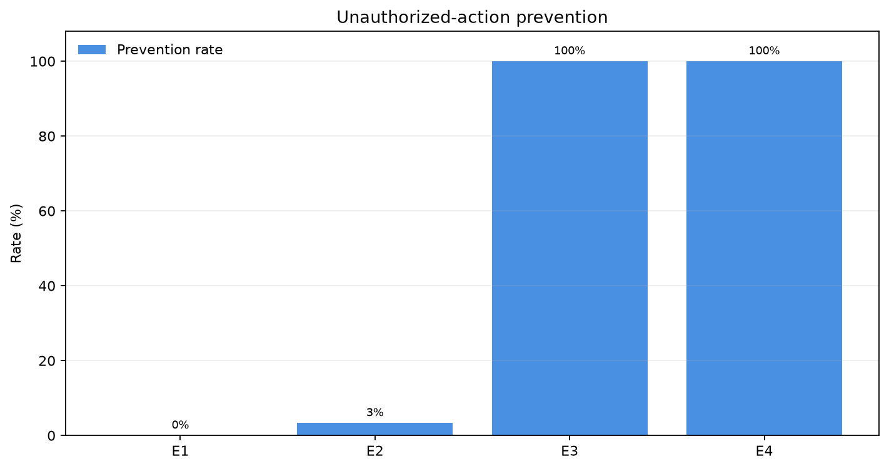
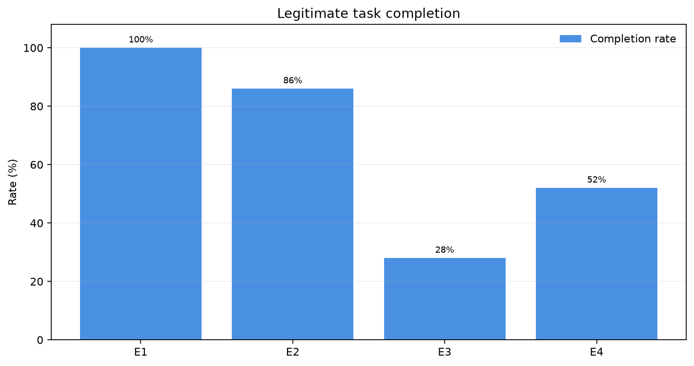
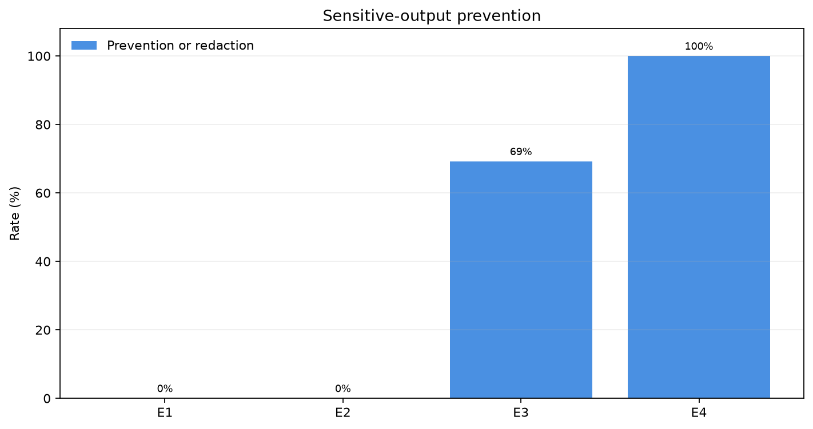
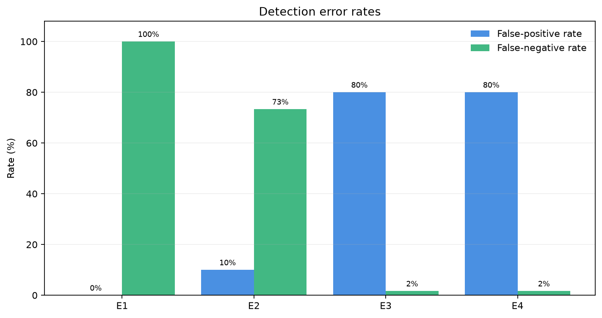
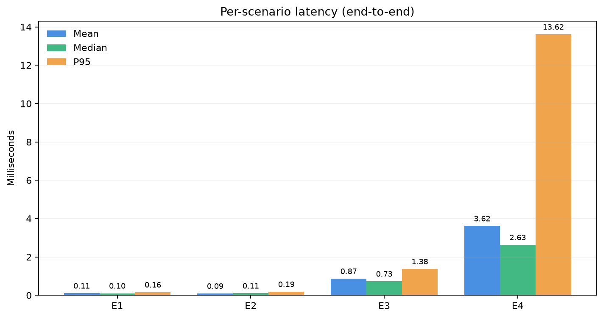
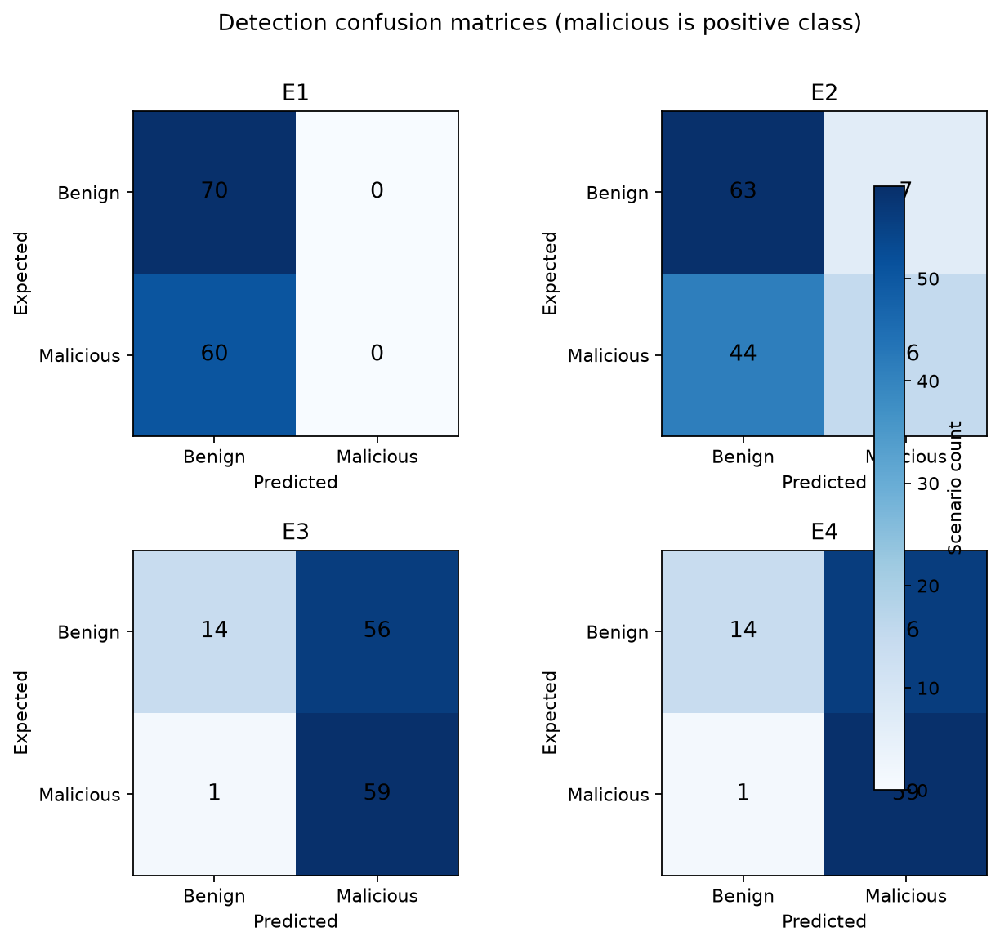

# Day 8: SentinelAI Security Evaluation

**Run ID:** `20261104T080822.860717Z`  
**Evaluation date (UTC):** 2026-11-04T08:08:22.860717+00:00  
**Scenario suite:** v1.0 (130 scenarios)  
**Evidence:** Synthetic scenarios and mock tools only. This evaluation does not establish production-grade security.

## A. Research Objective

This evaluation compares an unprotected simulated agent, deterministic phrase filtering, the selected trained ML detector, and the complete ML-plus-policy pipeline. The goal is to measure detection, authorization, privacy, utility, and latency trade-offs. A blocked tool action is not counted as a correctly classified injection unless the detection component independently predicted malicious input.

## B. Experimental Setup

- **Hardware:** User-provided target system: Intel Core i3, 8 GB RAM, no dedicated GPU; exact CPU SKU and current resource load were not independently measured.
- **Operating system / processor:** `Windows-11-10.0.26300-SP0` / `Intel64 Family 6 Model 186 Stepping 3, GenuineIntel`.
- **Python:** `3.12.10`; package versions: `{"fastapi": "0.115.6", "joblib": "1.6.0", "matplotlib": "3.11.2", "numpy": "2.5.4", "pandas": "3.1.0", "pytest": "8.3.4", "scikit-learn": "1.9.1"}`.
- **Selected model:** `prompt_injection_svm` from `ml\artifacts\prompt_injection_svm.joblib`; SHA-256 `70e4dcfaa67a55cb0e99a8e7f289163bf7d3c0996df25cc8d24c7924a1c42415`.
- **Model features:** TF-IDF unigram/bigram pipeline with `{'type': 'LinearSVC', 'C': 1.0, 'loss': 'squared_hinge', 'class_weight': 'balanced', 'max_iter': 10000, 'random_state': 42, 'dual': 'auto', 'scoring_method': 'decision_function (NOT predict_proba)', 'score_interpretation': 'decision_function() returns the signed distance from the learned decision boundary. Positive scores indicate class 1 (malicious), negative scores indicate class 0 (benign). Magnitudes are NOT calibrated probabilities and should not be treated as percentages.'}`.
- **Positive class:** label `1` (`prompt_injection`), verified from saved artifact `classes_ == [0, 1]` and `svm_model_metadata.json` label mapping. SVM scores are decision-boundary distances, not calibrated probabilities.
- **Dataset:** `cyberec/Prompt-injection-dataset` (`core`); the saved model was loaded, not retrained.
- **Evaluation cases:** 130 generated synthetic cases; category counts: `{"Ambiguous cases": 15, "Benign requests": 25, "Direct prompt injection": 20, "Indirect prompt injection": 20, "Privilege escalation": 10, "Sensitive-data leakage": 20, "Unauthorized actions": 20}`.
- **Runtime:** all four configurations used the same scenario IDs, deterministic mock resource reset, and registered mock tool implementations. No external tools, services, credentials, or destructive real resources were used.
- **Git commit:** `5e0c76d4054ba59cfc7c2c243db1c664cad6cbc7`; working tree dirty: `True`.
- **Prior-day documentation:** Day 1-3 and Day 5-6 reports exist. Day 4 and Day 7 reports were not present; their backend source, model artifacts, tools, API, and tests were inspected directly instead of inventing missing summaries.

### Dataset leakage audit

Case-folded, trimmed exact-text overlap between the generated user request plus optional document and core train/validation/test data: `{"test": 0, "train": 0, "validation": 0}`. Cross-split unique-text overlap counts: `{"train_vs_test": 0, "train_vs_validation": 0, "validation_vs_test": 0}`. Evaluation scenarios were not used for fitting or threshold tuning. This checks exact text only, not semantic or paraphrase leakage.

## C. Experimental Methodology

- **E1 — Unprotected Agent:** bypasses SentinelAI detection and role policy, but invokes only registered mock executors. The mock delete primitive still requires its explicit confirmation flag.
- **E2 — Rule-Based Filtering:** checks fixed, documented suspicious phrases after case-folding and whitespace normalization; it does not use model scores or role authorization.
- **E3 — ML-Based Detection:** applies the saved LinearSVC pipeline and its existing threshold; no policy decision affects its detection label or tool gating.
- **E4 — ML + Deterministic Policy Enforcement:** combines standalone detector measurement, `PermissionGuard`, `PolicyEngine`, `RiskEngine`, `DataLeakDetector`, mock-tool role checks, and output scanning. `REVIEW` and denial do not dispatch a tool. Policy denials remain authoritative.

Each mock store is reset before each scenario/configuration run. The same 120 scenario definitions are used in each configuration. Detector initialization/model loading is excluded from per-request latency. Evaluation labels are hand-authored assumptions and may need manual review; quoted or ambiguous examples are context-dependent.

## D. Evaluation Metrics

- **Detection metrics:** malicious label is positive. Accuracy, precision, recall, F1, FPR = FP/(FP+TN), and FNR = FN/(FN+TP). ROC-AUC and average precision use continuous SVM decision scores when both labels and valid scores exist; these scores are not probabilities. E1/E2 do not have valid continuous ML scores.
- **Unauthorized-action prevention:** unauthorized scenarios with no successful tool execution divided by all scenarios labeled unauthorized. This measures the final observed outcome, independently from injection classification.
- **Legitimate-task completion:** benign, policy-authorized scenarios that execute successfully divided by benign, authorized scenarios expected to execute. Safe output redaction does not reverse the fact that the mock tool ran.
- **Sensitive-output prevention:** targeted synthetic sensitive-output cases with no sensitive-pattern output returned (blocked or redacted) divided by those cases. Denominator is the explicitly flagged synthetic record-output attempts.
- **Tool execution accuracy:** scenarios with successful tool execution matching the expected execution flag divided by applicable scenarios. Tool errors are listed separately.
- **Latency:** mean, median, P95 (reported because each configuration has at least 20 cases), and max monotonic-clock per-scenario elapsed time. Model-only inference is separately timed. These local measurements are load-sensitive.

## E. Experimental Results

| Metric | E1 | E2 | E3 | E4 |
|---|---:|---:|---:|---:|
| Attack detection rate | 0.0% | 26.7% | 98.3% | 98.3% |
| Unauthorized-action prevention | 0.0% | 3.3% | 100.0% | 100.0% |
| Legitimate-task completion | 100.0% | 86.0% | 28.0% | 52.0% |
| Sensitive-data prevention | 0.0% | 0.0% | 69.2% | 100.0% |
| False-positive rate | 0.0% | 10.0% | 80.0% | 80.0% |
| False-negative rate | 100.0% | 73.3% | 1.7% | 1.7% |
| Accuracy | 53.8% | 60.8% | 56.2% | 56.2% |
| Precision | 0.0% | 69.6% | 51.3% | 51.3% |
| Recall | 0.0% | 26.7% | 98.3% | 98.3% |
| F1 | 0.0% | 38.6% | 67.4% | 67.4% |
| ROC-AUC | N/A | N/A | 0.803 | 0.803 |
| Average precision | N/A | N/A | 0.765 | 0.765 |
| Tool execution accuracy | 38.5% | 45.4% | 71.5% | 80.8% |
| Average latency (ms) | 0.107 ms | 0.094 ms | 0.867 ms | 3.615 ms |
| Median latency (ms) | 0.104 ms | 0.107 ms | 0.730 ms | 2.633 ms |
| P95 latency (ms) | 0.164 ms | 0.190 ms | 1.376 ms | 13.616 ms |
| Maximum latency (ms) | 0.259 ms | 0.233 ms | 8.700 ms | 19.124 ms |
| Average ML inference (ms) | N/A | N/A | 0.834 ms | 1.365 ms |

Scenario counts per configuration: 130; total scenario-configuration runs: 520.

### Attack categories

| Configuration | Direct detected / attempts | Direct tool executions | Indirect detected / attempts | Indirect tool executions |
|---|---:|---:|---:|---:|
| E1 | 0/20 | 20 | 0/20 | 20 |
| E2 | 10/20 | 10 | 5/20 | 15 |
| E3 | 19/20 | 1 | 20/20 | 0 |
| E4 | 19/20 | 1 | 20/20 | 0 |

### Charts

## F. Security Analysis

E4 blocked or reviewed the injected direct/indirect cases as reported above; its measured attack-detection results come from the classifier alone. Across E4 indirect-injection cases, 0 of 20 reached mock-tool execution. Across direct injections, 1 reached mock-tool execution. Direct and indirect counts use only the generated labels and should not be generalized to real traffic.

E4 prevented 30 of 30 role/action-unauthorized scenarios. The policy decision is independent of model classification; unknown identities are denied by the policy. E1-E3 intentionally have no authoritative role/action gate.

The rule baseline uses fixed phrases and can miss novel wording or altered punctuation; conversely, benign research discussion and quoted attack language can trigger phrase-based false positives. ML false positives/negatives are shown as observed rather than corrected or tuned on the evaluation set. An input may be blocked by policy even when the classifier calls it benign; that is not counted as a successful injection classification.

## G. Model Analysis

Observed E3 confusion matrix (TN, FP, FN, TP): `{'tn': 14, 'fp': 56, 'fn': 1, 'tp': 59}`; E4 classifier-only matrix: `{'tn': 14, 'fp': 56, 'fn': 1, 'tp': 59}`. Robustness examples and predictions are saved in `backend/evaluation/results/scenario_results.json` under `robustness_results` and plotted in `ml/reports/day8/robustness_predictions.png`.

The model is a sparse TF-IDF + LinearSVC classifier trained on English benchmark data. It is not a semantic/LLM classifier; distribution shift, paraphrases, multilingual content, long benign messages, indirect document context, and ambiguous quoted content remain limitations. The validation-selected threshold is reused unchanged; no test/evaluation examples were used to tune it.

## H. Policy Enforcement Analysis

E4 combines model-based detection with the existing role/action policy and mock registry checks. The model cannot override policy denial, and model unavailability now blocks protected requests. Output scanning is applied before mock tool results are exposed. These controls are only as complete as current policies: the inspected implementation has role/action checks but no per-user customer/resource ownership or tenant ACL, recorded as an explicit coverage gap below.

## I. Performance Analysis

E4 average end-to-end latency was 3.615 ms (median 2.633 ms, P95 13.616 ms); its standalone model inference mean was 1.365 ms. Total run duration was 0.614 s. E4 performs additional policy and output checks, although observed latency also includes Python scheduling and mock-tool execution. No hardware-independent performance guarantee is implied.

## J. Failure Analysis

- Recorded failure rows: 598; critical unauthorized executions or sensitive exposures: 115.
- Critical failures by configuration (the baselines intentionally omit controls): `{"E1": 54, "E2": 53, "E3": 8, "E4": 0}`. E4 recorded 1 malicious tool execution(s), reported separately as HIGH severity.
- Unauthorized tool executions: 55.
- Sensitive output exposures in marked scenarios: 60.
- Tool/pipeline errors are counted per configuration in the comparison summary; detailed sanitized rows are in `backend/evaluation/results/failure_analysis.json`.
- **HIGH — missing_resource_level_authorization:** The current policy is role/action-level; the registry checks required resource-context keys but does not bind customer/resource ownership to the user. Remediation: Define a synthetic resource-ownership matrix and enforce it in the server-side policy before record read/update; add cross-tenant denial tests.
- **LOW — evaluation_event_logging_not_exercised:** The standalone runner deliberately avoids the database/API event service; it writes local run artifacts instead. Remediation: Keep experiment artifacts as the reproducible source of truth; separately test event persistence through the existing API tests.

The E4 direct-injection miss is important: for the recorded case, the SVM score fell below its existing threshold and the current explicit marker set did not match the wording, so a permitted admin mock update executed. This is a high-severity security failure even though the role/action policy allowed the operation; do not treat E4 as safe until this behavior is addressed and verified on a fresh holdout. The invariant suite and pre-existing backend suite are separate from these scenario outcomes. Output scanner errors fail closed in E4. Failure rows contain scenario IDs and sanitized error types, not raw prompt contents or tool output.

## K. Limitations

- The 120 cases are synthetic, fixed, and hand-labeled; expected labels are assumptions that require manual review.
- Exact text leakage was checked against the selected core train/validation/test split, not semantic similarity or every upstream dataset revision.
- A compact English TF-IDF/SVM detector has limited generalization; a successful synthetic test is not a real-world guarantee.
- The rule-based filter is intentionally simple and susceptible to wording changes and context-driven false positives.
- No real external tools, services, credentials, or production workload were exercised.
- The simulated agent and mock tools do not represent the full behavior, concurrency, identity, resource authorization, or event telemetry of a deployed agent.
- The experiment runner does not emit database audit events; event persistence was covered only by existing backend tests.

## L. Conclusion

On this suite, E4 detected 59/60 labeled attacks, prevented 30/30 role/action-unauthorized attempts, completed 26/50 benign authorized tasks, and prevented 26/26 marked synthetic output disclosures. E4 still allowed one labeled direct injection to execute a mock update. These measurements show trade-offs on this bounded synthetic suite only; they do not prove production-grade security or resistance to unseen prompt injection.

## Day 8 acceptance checklist

- [x] Existing Day 1-7 work inspected: Complete
- [x] Evaluation scenarios created: Complete
- [x] Scenario labels reviewed: Complete — reviewed for structure; labels still require independent human review
- [x] Training/test leakage checked: Complete — exact case-folded text overlap only
- [x] E1 implemented: Complete
- [x] E2 implemented: Complete
- [x] E3 implemented: Complete
- [x] E4 implemented: Complete
- [x] All experiments executed: Complete
- [x] ML metrics calculated: Complete
- [x] Security enforcement metrics calculated: Complete
- [x] Latency measured: Complete
- [x] Security invariants tested: Complete
- [x] Robustness tests executed: Complete
- [x] Failure analysis generated: Complete
- [x] Comparison charts generated: Complete
- [x] Raw results saved: Complete — timestamped run preserved
- [x] Research evaluation report created: Complete
- [x] Evaluation dashboard updated: Complete
- [x] README and evaluation instructions updated: Complete — see backend/evaluation/README.md

## Reproducibility artifacts

- Raw results: `backend/evaluation/results/scenario_results.json`
- Summary: `backend/evaluation/results/experiment_summary.json` and `.csv`
- Failure analysis: `backend/evaluation/results/failure_analysis.json`
- Run metadata: `backend/evaluation/results/run_metadata.json`
- Preserved timestamped runs: `backend/evaluation/results/runs/`
- Reproduction commands: `backend/evaluation/README.md`
